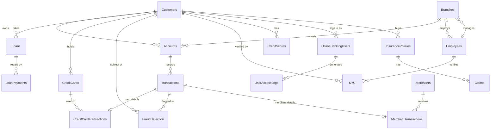

# SQL Banking System

**From database modeling to strategic business analytics.**

A complete banking database built in **Microsoft SQL Server (T-SQL)**: a 30-table relational schema, a synthetic dataset of about 10,500 rows, and six analytical queries that answer real business and risk questions (top customers, active loans, fraud monitoring, branch lending, and suspicious transaction patterns).


📄 **Presentation:** [BankingSystem.pdf](presentation/BankingSystem.pdf)

---

## Table of Contents

- [Problem and Goal](#problem-and-goal)
- [Database Architecture](#database-architecture)
- [Entity Relationships](#entity-relationships)
- [Data Integrity](#data-integrity)
- [Dataset](#dataset)
- [Analytics: KPI Queries](#analytics-kpi-queries)
- [Assumptions and Simulated Data](#assumptions-and-simulated-data)
- [Getting Started](#getting-started)
- [Project Structure](#project-structure)
- [SQL Skills Demonstrated](#sql-skills-demonstrated)
- [Roadmap](#roadmap)
- [Author](#author)

---

## Problem and Goal

**Problem: systemic crisis**

- Data was scattered and disconnected
- Reports took days to prepare
- There was no transparency in decision-making

**Goal:** one centralized database on SQL Server that is accurate, adapts to business needs, and solves data management problems at the root.

| Before | After |
|---|---|
| No transparency | Data integrity enforced by keys and constraints |
| Reports delayed by days | Reports and KPIs from a single query |
| Fragmented architecture | One centralized schema for all operations |

---

## Database Architecture

The `BankSystem` database contains **30 tables** grouped into six domains.

### Core Banking

| Table | Rows | Purpose |
|---|---:|---|
| `Customers` | 900 | Customer profiles (national ID, income, employment status) |
| `Branches` | 15 | Geographic branch network |
| `Employees` | 70 | Bank staff, linked to a branch |
| `Accounts` | 1,200 | Active and frozen accounts (Savings, Checking, Business) in UZS, USD, EUR |
| `Transactions` | 1,500 | Deposits, withdrawals, transfers, and payments |

### Cards and Digital Banking

| Table | Rows | Purpose |
|---|---:|---|
| `CreditCards` | 400 | Issued cards, limits, and status |
| `CreditCardTransactions` | 400 | Card transaction details (extends `Transactions`) |
| `OnlineBankingUsers` | 600 | Online banking credentials and last login |
| `MobileBankingTransactions` | 500 | Mobile app transactions: device and app version |
| `Merchants` | 90 | Merchant directory |
| `MerchantTransactions` | 300 | Merchant payments (extends `Transactions`) |
| `BillPayments` | 350 | Utility and biller payments |

### Lending and Credit

| Table | Rows | Purpose |
|---|---:|---|
| `Loans` | 220 | Mortgage, Personal, Auto, and Business loans |
| `LoanPayments` | 500 | Repayment history and remaining balance |
| `CreditScores` | 750 | Customer credit scores |
| `DebtCollection` | 70 | Overdue debts and assigned collectors |

### Compliance and Risk

| Table | Rows | Purpose |
|---|---:|---|
| `KYC` | 800 | Customer identity verification |
| `FraudDetection` | 50 | Transactions flagged with a risk level |
| `AML` | 25 | Anti-money-laundering cases |
| `RegulatoryReports` | 20 | Regulatory submissions |
| `UserAccessLogs` | 500 | Online banking activity log |
| `CyberSecurityIncidents` | 18 | Security incidents and resolution status |

### Human Resources

| Table | Rows | Purpose |
|---|---:|---|
| `Departments` | 10 | Departments and their managers |
| `Salaries` | 90 | Base salary, bonus, and deductions |
| `EmployeeAttendance` | 350 | Check-in and check-out times |

### Investments and Other Products

| Table | Rows | Purpose |
|---|---:|---|
| `Investments` | 180 | Customer investments and ROI |
| `StockTradingAccounts` | 150 | Brokerage accounts linked to bank accounts |
| `ForeignExchange` | 160 | Currency exchange operations |
| `InsurancePolicies` | 160 | Insurance products |
| `Claims` | 110 | Insurance claims |

---

## Entity Relationships

Simplified diagram of the main relationships (all links are enforced by foreign keys):



**How the keys work together**

- **Primary Key (PK):** every record has a unique, auto-generated identifier (`IDENTITY`).
- **Foreign Key (FK):** a strict logical and physical link between tables, so a transaction cannot exist without an account, and a loan payment cannot exist without a loan.
- Tables such as `CreditCardTransactions`, `MobileBankingTransactions`, and `MerchantTransactions` use the `TransactionID` as both their PK and an FK to `Transactions`, so each channel extends one central transaction record.
- `Branches.ManagerID` references `Employees`. This constraint is added with `ALTER TABLE` after the data is loaded, because branches and employees reference each other.

---

## Data Integrity

Integrity is enforced by the database itself, not by application code:

- **Primary keys** on every table (`IDENTITY(1,1)` surrogate keys)
- **Foreign keys** between related tables, which block orphan records
- **`UNIQUE` constraints** on `Customers.NationalID` and `CreditCards.CardNumber`
- **`CHECK` constraints** restricting allowed values:
  - `Transactions.TransactionType` ∈ `Deposit`, `Withdrawal`, `Transfer`, `Payment`
  - `Loans.LoanType` ∈ `Mortgage`, `Personal`, `Auto`, `Business`
- **`NOT NULL`** on critical fields (for example `FullName`, `NationalID`)
- **Defaults** such as `GETDATE()` for creation and update timestamps

---

## Dataset

The database is populated with a **synthetic dataset of about 10,500 rows** across all 30 tables (largest: `Transactions` with 1,500 rows, `Accounts` with 1,200, and `Customers` with 900).

> ⚠️ **All data is fictional.** Names, national IDs, card numbers, CVVs, password hashes, and amounts are randomly generated. No real customer data is used.

Row counts per table are listed in [Database Architecture](#database-architecture). Rare events are intentionally rare, as in a real bank (50 fraud flags, 25 AML cases, 18 security incidents).

---

## Analytics: KPI Queries

The `KPI` section at the end of `BankingSystem.sql` contains six analytical queries.

### 1. Top 3 customers by total balance

**Question:** which customers hold the most money across all of their accounts?
**Approach:** join `Accounts` to `Customers`, convert USD and EUR balances to a common currency with a `CASE` expression and fixed exchange rates, `SUM` per customer, then `TOP 3` ordered descending.

### 2. Customers with more than one active loan

**Question:** who carries multiple active loans, and how much do they owe in total?
**Approach:** filter `Loans` by `Status = 'Active'`, `GROUP BY` customer, and keep groups with `HAVING COUNT(...) > 1`. Returns the number of loans and the total loan amount.

### 3. Transactions flagged as fraud

**Question:** which transactions were flagged, who made them, and how risky are they?
**Approach:** join `FraudDetection`, `Transactions`, and `Customers` to show the customer, amount, currency, risk level, and transaction status.

### 4. Total loan amount issued by each branch

**Question:** how much has each branch lent?
**Approach:** a **CTE** aggregates loan amounts per branch (a customer's loans are attributed through the branch of the customer's accounts), then joins `Branches` for the branch name and city.

### 5. Multiple large transactions in a short time (under 1 hour)

**Question:** which customers made several large transactions less than an hour apart?
**Approach:**
1. Change `Transactions.Date` from `DATE` to `DATETIME`.
2. Add a random time of day to each row (to simulate real timestamps).
3. A CTE normalizes all amounts to USD with `CASE`.
4. The window function `LAG()` finds the previous large transaction per customer.
5. `DATEDIFF(MINUTE, ...) < 60` keeps the suspicious pairs.

### 6. Transactions from different countries within 10 minutes

**Question:** which customers transacted from two different countries within 10 minutes? This is a typical fraud signal.
**Approach:**
1. Add a `Country` column to `Transactions` and assign one of six countries (Uzbekistan, USA, UK, UAE, Kazakhstan, Turkey) at random.
2. A CTE uses `LAG()` over `PARTITION BY CustomerID ORDER BY Date` to get the previous transaction's time and country.
3. Keep rows where `DATEDIFF(MINUTE, ...) < 10` and the country changed.

**Business value:** millions of rows can be turned into short, actionable conclusions, and risks can be flagged before they grow into losses.

---

## Assumptions and Simulated Data

- **Exchange rates are fixed constants** inside the queries (for example `12.100` for USD and `13.800` for EUR). They are illustrative, not live rates.
- **Transaction times and countries are randomly generated** (`NEWID()` / `CHECKSUM()`) to simulate the scenarios in queries 5 and 6. Results of these two queries will differ each time the database is rebuilt.
- Branch attribution in query 4 uses the branch of the customer's accounts, because `Loans` has no branch column.

---

## Getting Started

### Prerequisites

- Microsoft SQL Server 2012 or later (Express edition is enough). Window functions such as `LAG()` need 2012+.
- SQL Server Management Studio (SSMS) or Azure Data Studio

> The script uses T-SQL syntax (`IDENTITY`, `GETDATE()`, `CHECKSUM`, `DATEDIFF`) and will not run as-is on MySQL or PostgreSQL.

### Run the project

1. Clone the repository:
   ```bash
   git clone https://github.com/<your-username>/sql-banking-system.git
   cd sql-banking-system
   ```
2. Open `sql/BankingSystem.sql` in SSMS.
3. Execute the whole script on a fresh server. It will:
   - create the `BankSystem` database,
   - create all 30 tables,
   - load the synthetic data,
   - add the `Branches.ManagerID` foreign key,
   - run the six KPI queries.
4. To explore a single KPI, select its block in the `KPI` section and press **Execute** (F5).

### Re-running the script

The script modifies data (`ALTER COLUMN`, `UPDATE`, `ADD Country`), so it is meant to run **once** on a fresh database. To start over:

```sql
USE master;
DROP DATABASE BankSystem;
```

---

## Project Structure

```
sql-banking-system/
├── README.md
├── sql/
│   └── BankingSystem.sql        # schema + data + KPI queries
└── presentation/
    └── BankingSystem_EN.pdf     # project presentation (English)
```

---

## SQL Skills Demonstrated

- **DDL and schema design:** 30 normalized tables, PK/FK, `UNIQUE`, `CHECK`, defaults
- **DML:** bulk `INSERT` of about 10,500 rows, `UPDATE`, `ALTER TABLE`
- **Joins:** multi-table `JOIN` across customers, accounts, loans, branches, and transactions
- **Aggregation:** `SUM`, `COUNT`, `GROUP BY`, `HAVING`, `TOP`
- **CTEs:** multi-step logic with `WITH` (queries 4, 5, 6)
- **Window functions:** `LAG() OVER (PARTITION BY ... ORDER BY ...)`
- **Conditional logic:** `CASE` for currency normalization and simulation
- **Date and time:** `DATEADD`, `DATEDIFF`, `DATE` → `DATETIME` conversion
- **Fraud analytics:** time-window and cross-country anomaly detection

---

## Roadmap

1. **Power BI integration:** in-depth data visualization and real-time dashboards for business owners
2. **Artificial Intelligence:** automatic credit scoring and risk prediction
3. **Big Data scaling:** indexing methods to process millions of transactions within seconds

---

## Author

**Javohir Yunusov**

[LinkedIn](https://www.linkedin.com/in/javohir-yunusov-705424295) · [Telegram](https://t.me/yunusovv66)

> Educational portfolio project. All data is synthetic.
